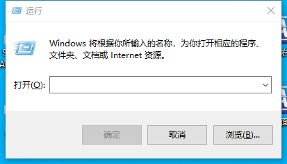
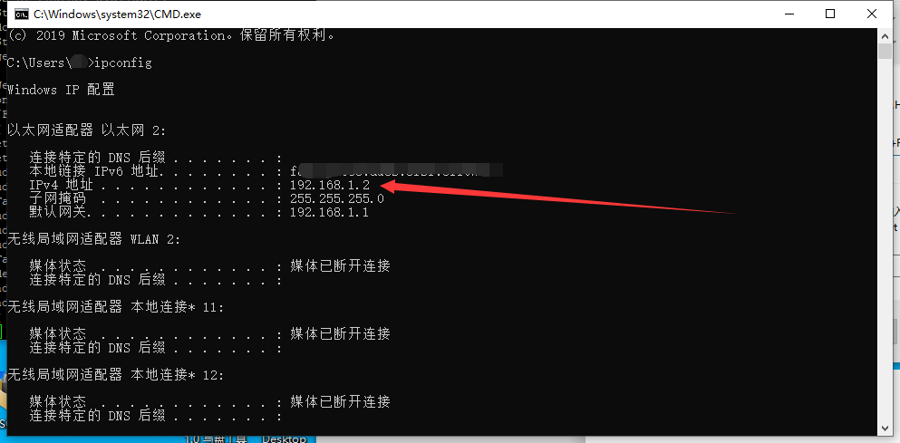
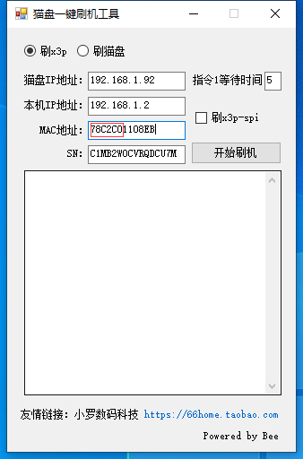
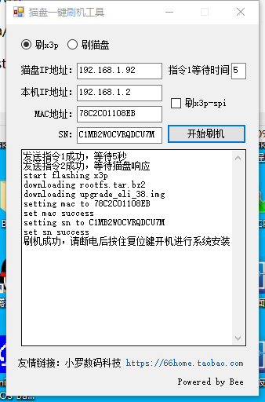

# 猫盘刷 X3P 一键 V2.0 使用说明

> 本教程为Bee制作的离线安装系统工具使用简单说明，需要保姆式服务的大爷，不需要继续看了。退群吧，我能力有限。
> 刷机工具下载：https://github.com/aabacada/maopan/releases/download/1/1-Maopan-shua-X3P.V2.0.zip
猫盘通电（不管现在是什么系统,H大的除外），获取猫盘IP地址。不知道怎么看猫盘地址的不用继续了。

获取本机PC的ip地址   win键+R  输入 cmd

关闭win防火墙（百度去）

打开刷机工具，填入正确的IP地址

填入SN和mac地址，（猫盘机壳底部）

注意，需要全部大写。Mac仅需要修改后6位，如图所示。78C2C0XXXXXX

刷机很快，预计1分钟。如图即可断电。

按住复位键，插入电源，复位键需要按10S

可以去撸几次，预计5-15分钟机器会自动重启。

完了

没了

不出IP就等死吧

执行大群救砖流程
