# 猫盘玩机一站式解决方案（含一键刷机工具）

> **作者**：百花齐放　|　**分类**：猫盘专栏　|　**发布**：2021-09-25　|　**更新**：2022-04-05
> **原文**：<https://www.huakings.cn/post/283.html>

---


> **摘要：**
>  玩猫盘的时间也长了，三年走来，猫盘依旧还在，网上的各位大神不断的研究，不管是刷机方法还是玩机技巧都是化繁为简，本博客在各位的观注下一路走来不容易，其中不乏有支持，也有不同的杂音，本...

玩猫盘的时间也长了，三年走来，猫盘依旧还在，网上的各位大神不断的研究，不管是刷机方法还是玩机技巧都是化繁为简，本博客在各位的观注下一路走来不容易，其中不乏有支持，也有不同的杂音，本网始终坚持免费的原则，破解一些网络壁垒（比如会员制、论坛的积分制），本着分享的精神给大家码字出教程，这就是一个整理的过程，避免大家来回奔波，这次出一个更全的玩机教程，提供一站式服务，希望大家能玩的开心。

如果下载链接失效，请进QQ群：924610783，群文件里全有。

[](images/img_02.jpg)

## 第一篇章：最简刷机方案

### 一、猫盘原系统（或X3P）刷机群晖

本地方案就是用一键刷机洗白工具进行刷机，我们在进行操作时需要首先关闭防火墙，然后把猫盘接入路由器，在路由器后台查看猫盘的IP（记下来），然后再在网络中心查看电脑的IP（记下来），然后到工具中心分别填上两个IP地址即可，再点击刷机，等待10分钟左右，显示刷机成功即可，这个工具刷的是DS119J的群晖引导。

<https://cloud.189.cn/web/share?code=rmQNNr2aEbUn>（访问码：71sv）

相关操作如图：

[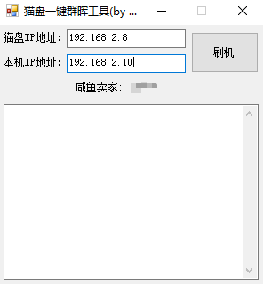](images/img_03.png)

[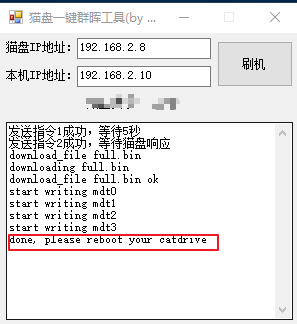](images/img_04.png)

### 二、猫盘群晖刷X3P

先把两个文件放到群晖的目录内，比如我就是放入/volume1/video中，其中两个文件分别为：

syno_to_x3p.sh

x3p_full.bin

然后通过控制面板添加执行任务或者用ssh登陆root用户，再执行刷机命令：

```bash
bash /volume1/video/syno_to_x3p.sh
```

等待10分钟左右，即能把X3P的引导刷入flash芯片内，然后把系统固件包拷到U盘（记得U盘格式为fat32)，固件包分别为：

rootfs.tar.bz2

upgrade_eli_38.img

这样把U盘接到猫盘上（具体如何接可以参照本站教程），按住reset键后通电（按住不放15秒-30秒左右，然后松开），即完成了刷机。

（当然也可以用TTL线直接来把X3P_full.bin文件写入，本站博客也是有的，适用于任何系统刷入X3P)

<https://cloud.189.cn/web/share?code=fE7J7vmIZBre>（访问码：nb1v）

相关操作如图：

[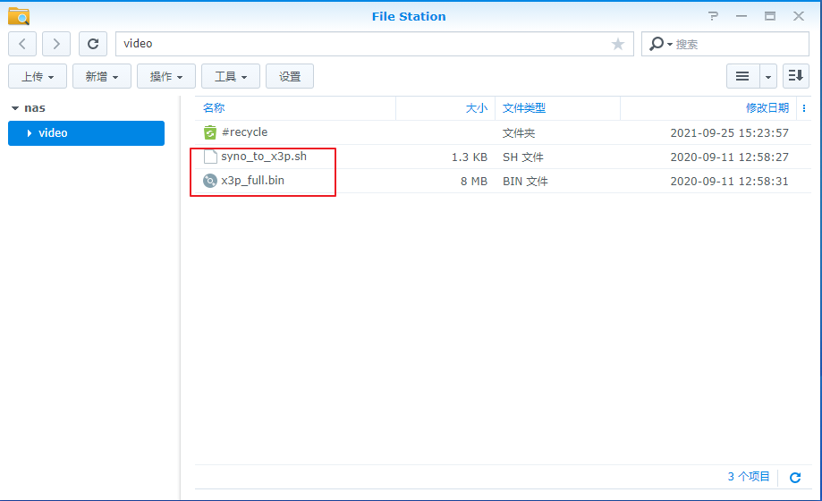](images/img_05.png)

[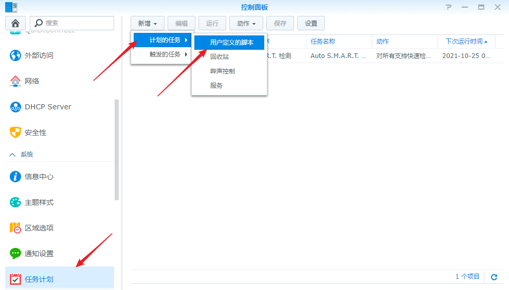](images/img_06.png)

[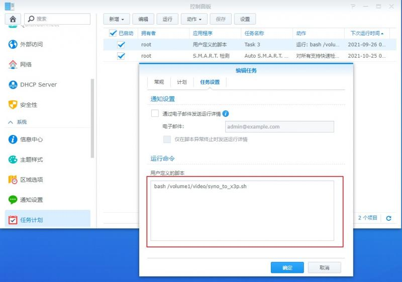](images/img_07.jpg)

[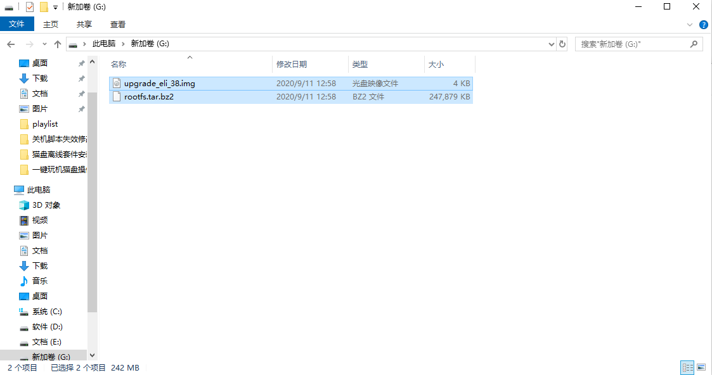](images/img_08.png)

### 三、猫盘原系统刷X3P

记得先关闭防火墙，然后使用一键刷X3P工具包进行刷机，注意的地方就是MAC地址前6位要为78C2C0（后面6位可以写猫盘后6位），再把猫盘的SN码也填写进去，点开始刷机即可，刷机成功 就可以拔掉电源 按住猫盘的复位键插上电源 注意：（插上电源不要松手保证在15秒以上）期间风扇会转。慢慢等待 观察路由器后台里面的ip地址出现，表明刷机成功在浏览器输入猫盘IP即可进入X3P管理页面，默认账号：admin，密码：123456

<https://cloud.189.cn/web/share?code=nmyQZzvu63A3>（访问码：39jv）

相关操作如图：

[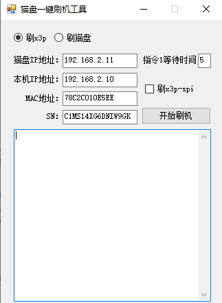](images/img_09.png)

[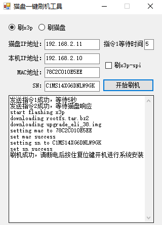](images/img_10.png)

刷机成功后，可以通过上传进行APP安装：

<https://cloud.189.cn/web/share?code=M7RzuqEbIvMz>（访问码：hmc2）

相关操作如图：

[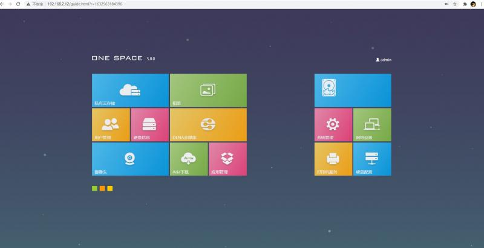](images/img_11.jpg)

[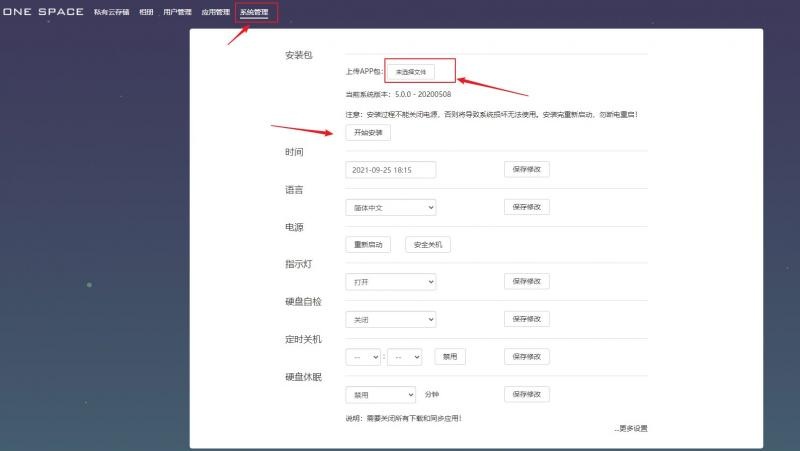](images/img_12.jpg)

### 四、X3P刷群晖（线上一键刷机）

使用网线连网一键刷机，先用SSH登陆，用户名：root 密码：Etech12，然后输入命令：

```bash
wget -N --no-check-certificate https://www.huakings.cn/mp202003/catdrive-syno/install.sh && chmod +x install.sh && bash install.sh
```

相关操作如图：

[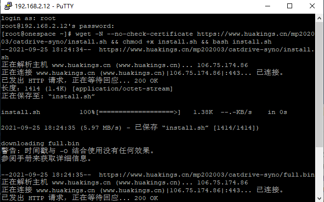](images/img_13.png)

[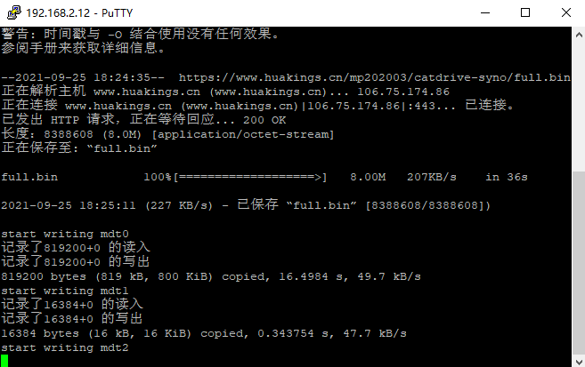](images/img_14.png)

### 五、第三方系统刷回原系统

这个需要借助一下TTL线先把full.bin刷入，然后把两件文件拷到U盘（格式需要fat32),分别为：rootfs.tar.bz2和upgrade_eli_38.img，然后按住reset键不动刷入这个固件包，然后进入系统，用户名：root，密码：Etech12，登陆后设置一下MAC和SN即可，命令分别为：

读SN

/opt/bin/sn_tool read

SP03BV100001022A

然后看机器背面的SN码再写入自己的SN码

写SN

/opt/bin/sn_tool write "C2CS17T1UKRCNS4"   C2CS17T1UKRCNS4为自己机器背面SN号

读mac

/opt/bin/mac_tool read 1

然后看机器背面的MAC码再写入自己的MAC码

写mac

/opt/bin/mac_tool write 1 "78:c2:c0:11:71:18"   78:c2:c0:11:71:18为自己机器背面的MAC码

<https://cloud.189.cn/web/share?code=7fuAj2MvUVVb>（访问码：rf0t）

## 第二篇章：群晖系统安装

### 一、群晖的安装

下载群晖助手，然后点“搜索”，出现"DSM未安装”，选中它然后点击“联机”，这样就能弹出网页并搜索到安装界面，特别提到的一点就是建议安装离线系统包，即“DSM6.2.3-25423”这个版本，下载的官网为：www.synology.com,到里面下载bat文件即可，详细见本网的文章：[猫盘详细使用说明](https://www.huakings.cn/post/251.html)，

整个过程大约为15-25分钟左右，其间注意的几点：

新硬盘可以直接接上安装，如果是老旧的硬盘需要挂载到电脑上重新格式化一次才行;

再来就是安装时一定选择对应的安装包，比如119的引导就选择DS119J-DSM6.2.3-25423，120的引导选择DS120j-dSM6.2.3-25423;

安装完后需要做几个动作，同步时间和设置DNS（8.8.4.4和114.114.114.114）

这里将重点的几个步骤贴图出来，以供参考：

搜索并联机：

[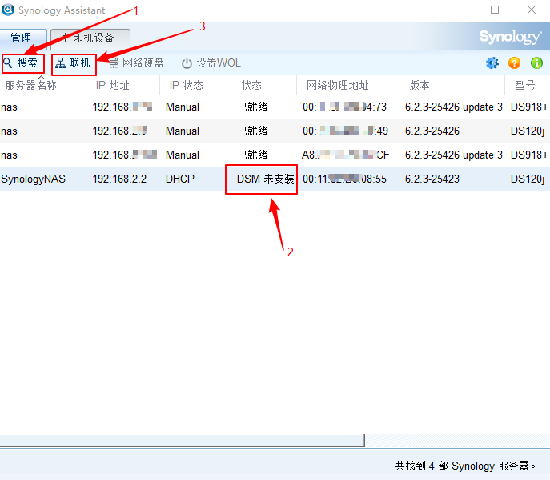](images/img_15.png)

选择离线包安装及如何“下一步”安装

[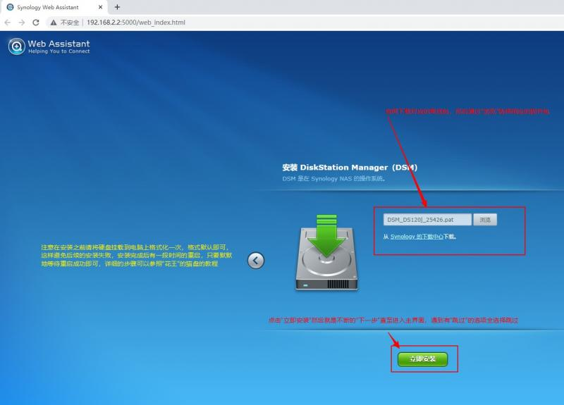](images/img_16.jpg)

四个步骤拼图：

[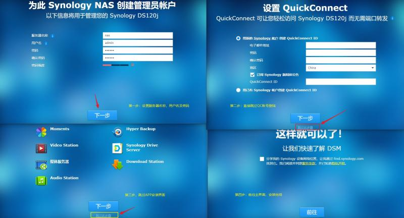](images/img_17.jpg)

简单的配置入口如图：

[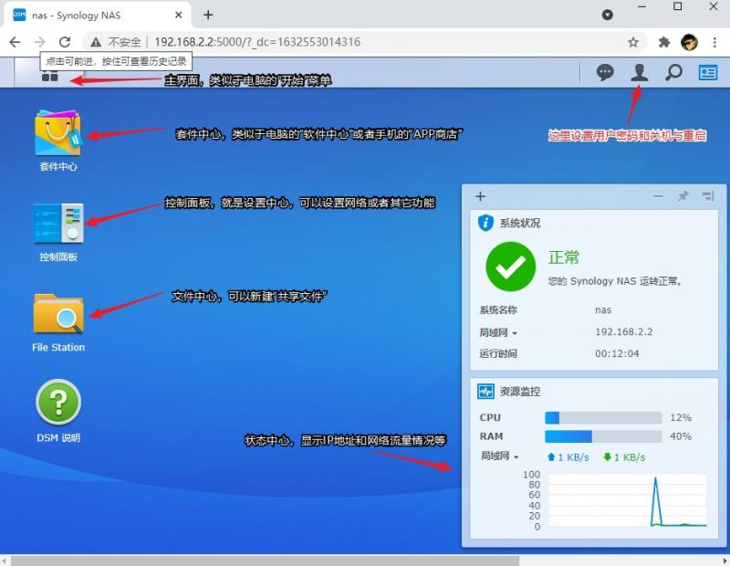](images/img_18.jpg)

需要用的几个控制面板设置：

[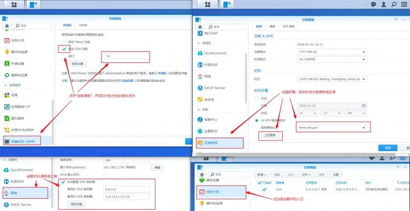](images/img_19.jpg)

### 二、各个脚本的安装

1、三合一脚本，适合于DS120J，这个能控制LED灯亮、休眠、关机（大猫适用），详细见本站教程：

[DS120J猫盘三合一完美脚本](https://www.huakings.cn/post/249.html)

[万能的脚本让猫盘变完美](https://www.huakings.cn/post/224.html)

```bash
#120j小猫盘（暂不支持完美关机）

cd ~ && wget -N --no-check-certificate https://www.huakings.cn/mp202003/120/cat120j.sh && chmod +x /root/cat120j.sh && bash /root/cat120j.sh 120X

#120j大猫盘（支持完美关机）

cd ~ && wget -N --no-check-certificate https://www.huakings.cn/mp202003/120/cat120j.sh && chmod +x /root/cat120j.sh && bash /root/cat120j.sh 120D

#120j恢复原始配置

cd ~ && wget -N --no-check-certificate https://www.huakings.cn/mp202003/120/cat120j.sh && chmod +x /root/cat120j.sh && bash /root/cat120j.sh 120bak
```

2、DS119J有脚本需要逐个运行：

（1）控制LED灯的脚本：

[**LED脚本文件下载**](https://pan.huakings.cn/%E7%8C%AB%E7%9B%98%E4%B8%93%E5%8C%BA/0301.%E7%8C%AB%E7%9B%98%E7%BE%A4%E6%99%96%E7%9A%84%E8%84%9A%E6%9C%AC%E6%96%87%E4%BB%B6/LED%E7%81%AF%E8%84%9A%E6%9C%AC%E6%96%87%E4%BB%B6/aw2013_led_syno.sh)

<https://cloud.189.cn/web/share?code=uQ73IziyQ3Ub>（访问码：qhx7）

```bash
#关机LED灯脚本

bash /volume1/video/aw2013_led_syno.sh red

#开机LED灯脚本（小猫）

bash /volume1/video/aw2013_led_syno.sh green

#开机LED灯脚本（猫盘PLUS）

bash /volume1/video/aw2013_led_syno.sh blue
```

（2）完美关机（大盘PLUS适用）

```bash
cd ~ && wget -i https://www.huakings.cn/mp202003/poweroff.txt && mv -f /etc/init/poweroff.conf /etc/init/poweroff.conf.bak && mv -f /root/poweroff.conf /etc/init/ && rm -f /root/poweroff.txt
```

（3）休眠脚本

```bash
cd ~ && wget -N --no-check-certificate https://www.huakings.cn/mp202003/syslog-ng.conf && chmod 644 syslog-ng.conf && mv -f /etc/init/syslog-ng.conf /etc/init/syslog-ng.conf.bak && mv -f /root/syslog-ng.conf /etc/init/
```

3、改SN码和MAC（或者洗白）、适用DS119J和DS120J

```bash
cd ~ && wget -N --no-check-certificate https://www.huakings.cn/mp202003/macsn.sh && chmod +x macsn.sh && bash macsn.sh 00:11:32:12:34:56 1860ABCDE1860 && rm -f /root/macsn.sh
```

## 第三篇章：猫盘硬件改造

猫盘的改造，也就是硬件的改造，一种是在原来的基础上改造，比如加USB、加UPS、改装风扇等，一种是直接DIY外壳，种种改造都是尽可能的完成更好的体验，大家有兴趣的可以去试试：

### 一、小猫的改造：

（1）增加12V降5V模块和SATA线，改造成支持3.5寸硬盘的猫盘（外置）：[传送门](https://post.smzdm.com/p/aekwkr9k/)

[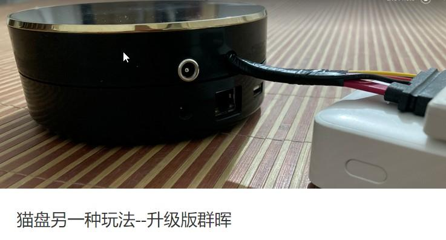](images/img_20.jpg)

（2）DIY外壳，支持2.5寸硬盘（超1.9CM）和3.5寸硬盘

相关教程可以参考：[亚克力猫盘改造](https://www.huakings.cn/post/260.html)

[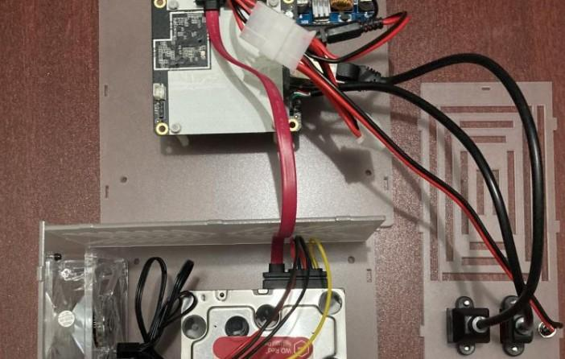](images/img_21.jpg)

（3）改风扇，更静音

（4）增加USB口并开USB口

### 二、大猫的改造

（1）增加继电器或电容，达到通电开机的目的，配合WIFI模块实现远程开机

相关教程可以参考：[猫盘PLUS的通关玩法](https://www.huakings.cn/post/202.html)

[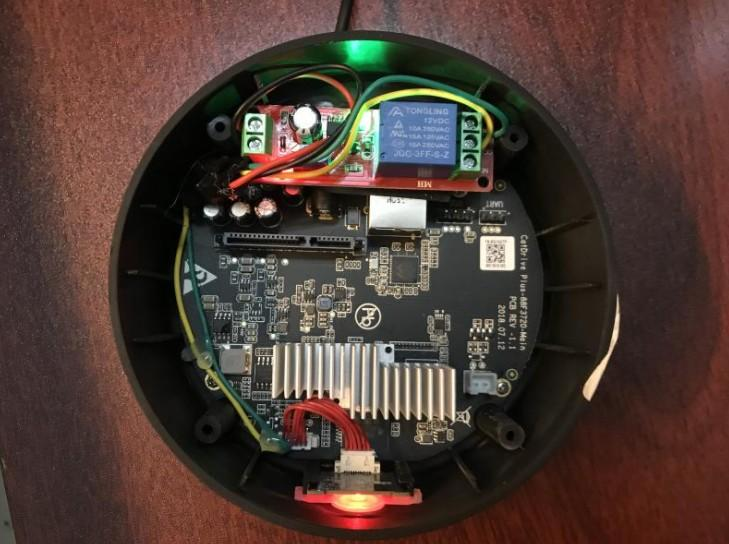](images/img_22.jpg)

（2）增加USB口并且开孔

（3）增加石硬盘顶部风扇，扩大散热

（4）增加UPS，实现断电保护

## 第四篇章：猫盘玩法集合

### 一、安装官方的7大套件：

官方的套件，可以直接在套件中心下载使用，玩群晖必备的套件，非常好用

| 序号 | 图标 | 名称 | 说明 | 教程 |
| --- | --- | --- | --- | --- |
| 1 | [](images/img_23.png) | File | 管理文件，手机端可以用来备份照片相当好用 | [点击前往](https://www.huakings.cn/post/277.html) |
| 2 | [](images/img_24.png) | Video | 官方的媒体播放套件，有海报有剧集介绍 | [点击前往](https://www.huakings.cn/post/273.html) |
| 3 | [](images/img_25.png) | Drive | 协同办公软件，可以通过网页端直接访问办公软件并实时多人办公 | [点击前往](https://www.huakings.cn/post/272.html) |
| 4 | [](images/img_26.png) | Cloud | 官方的云同步套件，使用它可以用公用云（如百度云）备份群晖的文件 | [点击前往](https://www.huakings.cn/post/271.html) |
| 5 | [](images/img_27.png) | Web | 建网站套件，可以建博客和群晖导航页 | [点击前往](https://www.huakings.cn/post/276.html) |
| 6 | [](images/img_28.png) | Audio | 群晖自带的音乐播放软件，非常好用，可以多设备播放歌曲 | [点击前往](https://www.huakings.cn/post/274.html) |
| 7 | [](images/img_29.png) | Moment | 自带的多媒体查看套件，上面可以直接播放手机照片与视频 | [点击前往](https://www.huakings.cn/post/275.html) |

### 二、安装第三方套件

安装第三方套件有两种方法，手动安装离线包和使用第三方套件源来安装，这里也将展开来讲：

1、使用第三方套件源安装套件

首先打开套件中心，点开设置，然后打开常规，勾选“任何发行者”，点确认，然后再点击“套件来源”来添加第三方源

[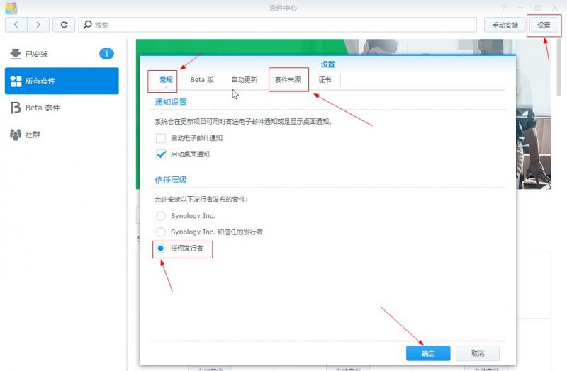](images/img_30.jpg)

添加第三方源时需要填写正确的源地址，然后保存成功

[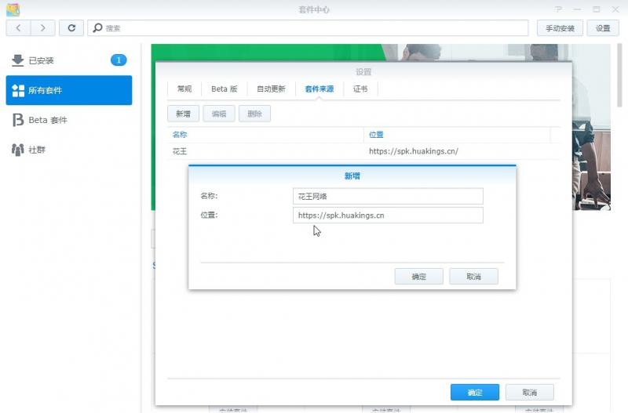](images/img_31.jpg)

保存成功后就能在社群里下载安装第三方套件了

[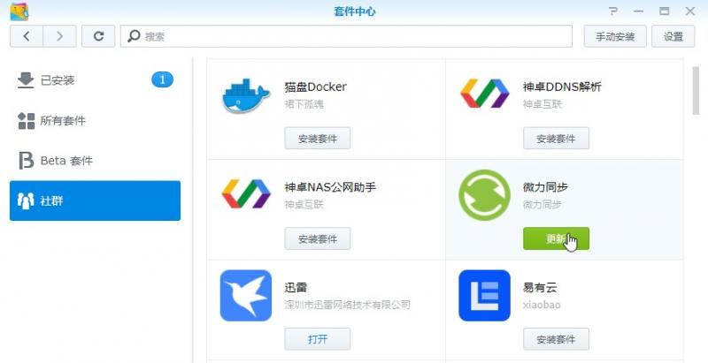](images/img_32.jpg)

推荐的第三方源地址：

```text
#国服群晖NAS第三方套件源
https://spk.520810.xyz:666
#第三方工具entware
https://www.cphub.net
#SynoCommunity
http://packages.synocommunity.com
#SynoCommunity(Beta)
http://packages.synocommunity.com/?beta=1
#ACMENet
http://synology.acmenet.ru
#community package hub
http://www.cphub.net
#Cambier
https://synology.cambier.org/
#Dierkse
http://syno.dierkse.nl/
#FileBot
https://get.filebot.net/syno/
#Hildinger
http://www.hildinger.us/sspks/
#Netzbär
https://spk.netzbaer.de/
#PC LOAD LETTER
http://packages.pcloadletter.co.uk/
#PulseStation
http://www.pulse-station.com/repo/
#SysCo.ch
http://synology.sysco.ch
#nas-mirror.de
https://dp.diandongzhi.com/?acct=144&site=nas-mirror.de
```

2、离线套件包

先提供一些比较好点的，猫盘能用的离线套件包，后续再分享如何使用它们

详细见花王网盘，里面全有，谢谢！导航页面“猫盘专区”--“花王网盘”

| 序号 | 图标 | 套件名称 | 套件说明 |
| --- | --- | --- | --- |
| 1 | [](images/img_33.png) | 迅雷 | 磁力种子下载工具，内测码:gebi1 |
| 2 | [](images/img_34.png) | Aria2 | 没有线程限制，Aria2 是一个多平台轻量级，支持 多协议下载 |
| 3 | [](images/img_35.png) | DDNS-GO | 绑定动态DDNS，支持阿里腾迅云等 |
| 4 | [](images/img_36.png) | 猫盘Docker | 猫盘上运行的容器可用于某东签到 |
| 5 | [](images/img_37.png) | IPTV管理系统 | 默认管理员:admin，默认安全码和密码:123456。后台+前端APP |
| 6 | [](images/img_38.png) | Jellyfin | Jellyfin是一款免费软件媒体系统，是Emby和Plex的替代产品。 |
| 7 | [](images/img_39.png) | PanIndex | 挂载阿里云与天翼云盘并分享,本套件默认密码：PanIndex |
| 8 | [](images/img_40.png) | qBittorrent | PT/bt下载的神器，默认:admin，密码:adminadmin |
| 9 | [](images/img_41.png) | V P N 服务器 | 用群晖建一个服务器，达到异地组网 |
| 10 | [](images/img_42.png) | Zerotier | 虚拟局域网，没有公网也能“回家” |

---

## 附：正文相关链接

- [猫盘详细使用说明](https://www.huakings.cn/post/251.html)
- [DS120J猫盘三合一完美脚本](https://www.huakings.cn/post/249.html)
- [万能的脚本让猫盘变完美](https://www.huakings.cn/post/224.html)
- [LED脚本文件下载](https://pan.huakings.cn/%E7%8C%AB%E7%9B%98%E4%B8%93%E5%8C%BA/0301.%E7%8C%AB%E7%9B%98%E7%BE%A4%E6%99%96%E7%9A%84%E8%84%9A%E6%9C%AC%E6%96%87%E4%BB%B6/LED%E7%81%AF%E8%84%9A%E6%9C%AC%E6%96%87%E4%BB%B6/aw2013_led_syno.sh)
- [传送门](https://post.smzdm.com/p/aekwkr9k/)
- [亚克力猫盘改造](https://www.huakings.cn/post/260.html)
- [猫盘PLUS的通关玩法](https://www.huakings.cn/post/202.html)
- [点击前往 · File](https://www.huakings.cn/post/277.html)
- [点击前往 · Video](https://www.huakings.cn/post/273.html)
- [点击前往 · Drive](https://www.huakings.cn/post/272.html)
- [点击前往 · Cloud](https://www.huakings.cn/post/271.html)
- [点击前往 · Web](https://www.huakings.cn/post/276.html)
- [点击前往 · Audio](https://www.huakings.cn/post/274.html)
- [点击前往 · Moment](https://www.huakings.cn/post/275.html)

> 说明：文中「LED脚本文件下载」「传送门」原为站内 base64 跳转链接，已还原为真实目标地址。
> 天翼云盘分享地址后的括号内为原文标注的访问码。
