# 猫盘刷ONE SPACE及群晖固件教程

*发布日期：2019-12-09　|　作者：2222　|　分类：数码硬件、日常杂谈　|　阅读量：30,779*

*原文地址：<https://lishuma.com/archives/2974>*

---

> **⚠️ 内容过时提醒：**
> 本文发布于 2523 天前，鉴于时间推移，文中所涉信息可能已发生变化，其准确性及时效性无法保证，仅供参考。

猫盘是近期比较热门的矿难产物之一，主要亮点是可以内置硬盘，而不用像玩客云这类只能外挂硬盘盒。而且配置和群晖DS119J基本一样，内存还大了一倍。

实际一个多月前60块钱捡的，不过一直拖延症+空余时间不多，到现在才开始折腾，目前这玩意儿行情也涨到了100块钱左右。

[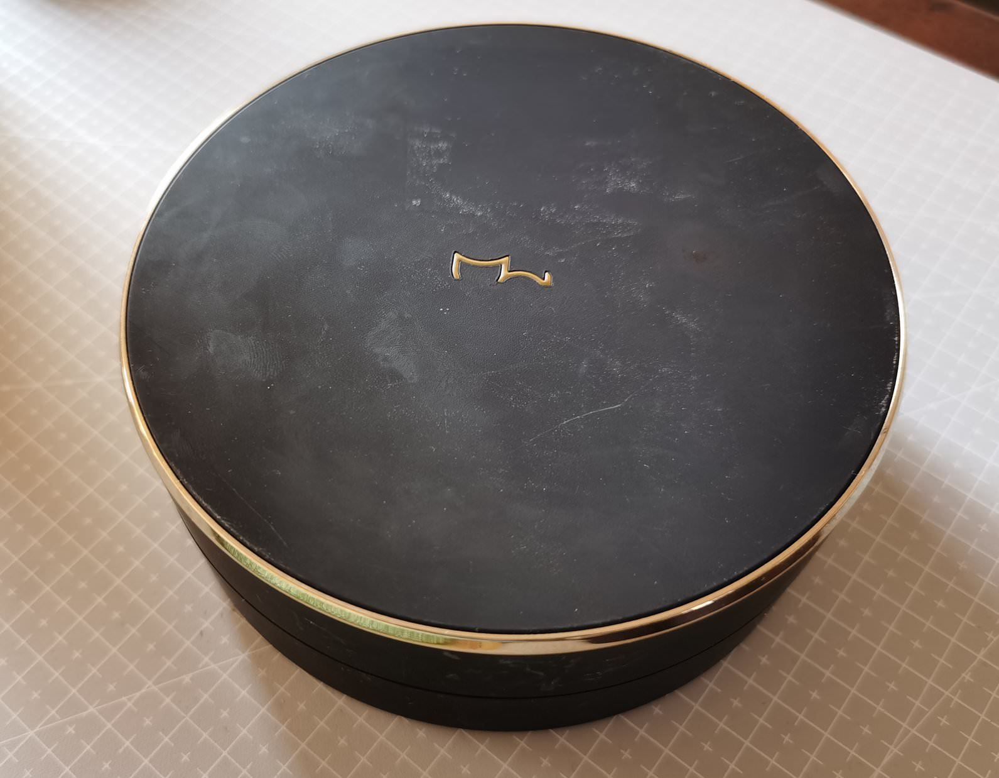](images/01-IMG_20191208_162710-.jpg)

[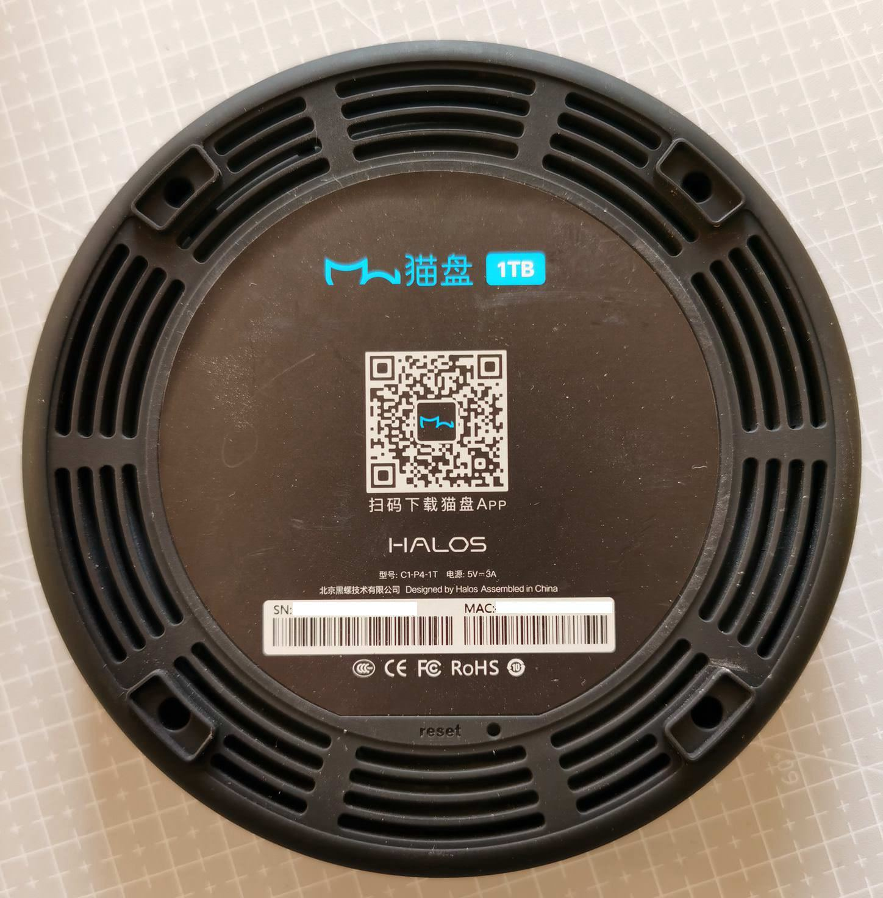](images/02-IMG_20191208_155251-.jpg)

这里我买到的是HALOS版本，市面上还有另一种catdrive版本的，部分硬件细节微微有点不同。本教程只保证HALOS版本可用，catdrive版请自行研究。

**另外还有一种大号的猫盘plus型号，可以装3.5寸硬盘，也不适用于此教程，务必注意！不要手贱乱刷！**

刷群晖的话，由于开启猫盘原始系统的SSH需要用到TTL，本人比较懒，所以这里借助另一款跑路矿渣X3P的固件来作为过渡包，然后在X3P的固件基础上再刷到群晖。

首先下载所需的所有资料并解压：

```text
百度云链接：https://pan.baidu.com/s/18SlbzsQPfu3FneP24FuS4A 提取码：rw23
```

```text
天翼云盘备份链接：https://cloud.189.cn/t/N7vYNj2aqU73（访问码：1303）
```

把猫盘插电连上路由， 硬盘不用接 ，并到路由器管理界面查看对应的IP，我这里是192.168.2.150：

[](images/03-catdrive-02.jpg)

进入 一键刷机工具目录，管理员身份运行CatDrive_flasher，有杀软啥的都先退掉，win系统的防火墙也暂时关掉：

[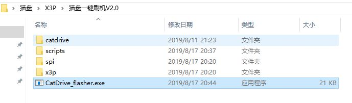](images/04-catdrive-01.jpg)

IP地址都填写好对应的，MAC地址前六位固定为 78C2C0 ，后六位填上自己猫盘上的后六位，比如你MAC后六位为 A1B2C3 ，那么整个MAC就是 78C2C0A1B2C3 。序列号也填写好，注意MAC和SN都要全部大写，如下图：

[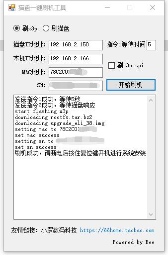](images/05-catdrive-03-1.jpg)

看到成功后，软件就可以关了，此时猫盘指示灯会是红色常亮。

把猫盘电源拔了，网线不用动，按住复位键的同时再插上电，看到指示灯变成蓝色闪烁后就可以松开复位键了，会自动进行X3P系统安装，耐心等待大约5-10分钟，看到指示灯又变成红色常亮后，就说明刷好了。

这时候注意，由于刷完机后设备名字就变了，需要再次到路由器管理界面查看对应的IP，比如我这里就变成了192.168.2.40：

[](images/06-catdrive-04.jpg)

浏览器里输入对应IP即可看到ONESPACE界面，默认用户名admin，密码123456：

[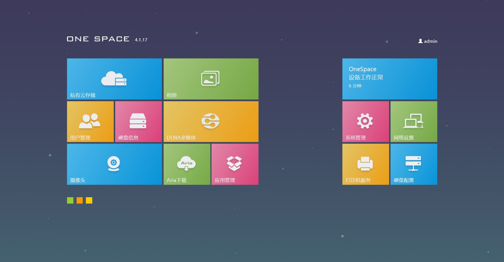](images/07-catdrive-05.jpg)

ONE SPACE系统实际本身已经很完善了，各项NAS的基本功能都很齐全，足够满足日用，打算使用这系统的话，搭配的硬盘需要格式化成ext4再放进去 。下载链接的x3plus文件夹里提供了从旧到新的固件，升级的话，注意按照日期顺序，从旧到新一个一个逐步升级，不要直接跨版本。

不过这里目标还是刷群晖系统，继续往下走。

**这时候可以把硬盘装进去了，注意先删掉所有分区。**

刷完X3P系统后，就可以通过SSH连接猫盘了，使用WinSCP这类客户端，选择SFTP模式，输入猫盘当前IP地址，用户名root，密码Etech12，点击连接：

[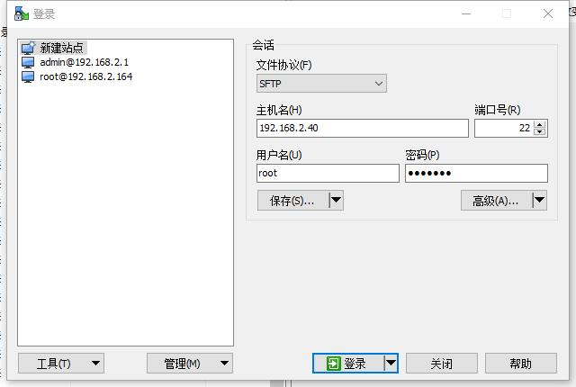](images/08-catdrive-06.jpg)

然后把群晖的引导文件full.bin放进去，我这里直接丢到tmp目录下，然后用putty这类客户端SSH连接上猫盘，root用户登陆，切换到存放引导文件的目录下：

```bash
cd /tmp
```

然后执行以下四条命令，可以复制粘贴，输入一个回车执行一次，等到有反馈后再执行下一条：

```bash
dd if="full.bin" of=/dev/mtdblock0 bs=1 skip=0 count=$((0xc8000))
```

```bash
dd if="full.bin" of=/dev/mtdblock1 bs=1 skip=$((0x000c8000)) count=$((0x00004000))
```

```bash
dd if="full.bin" of=/dev/mtdblock2 bs=1 skip=$((0x000cc000)) count=$((0x00434000))
```

```bash
dd if="full.bin" of=/dev/mtdblock3 bs=1 skip=$((0x00500000)) count=$((0x00300000))
```

四条命令执行完后应该如图所示：

[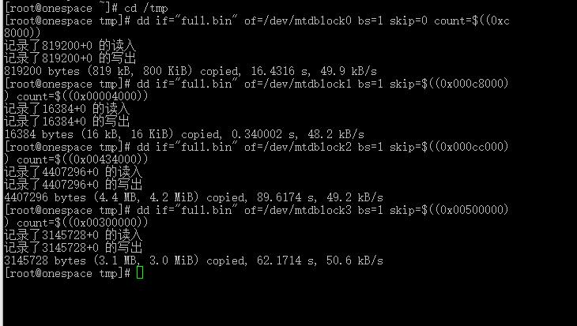](images/09-catdrive-07.jpg)

最后直接输入reboot重启即可。

然后浏览器里打开群晖的在线安装地址：[http://find.synology.com/](http://find.synology.com/)  ，点一下搜索设备，可以看到已经把猫盘当成了DS119J，也显示了设备的IP等信息，点击联机，按照提示一步步进行系统安装即可：

[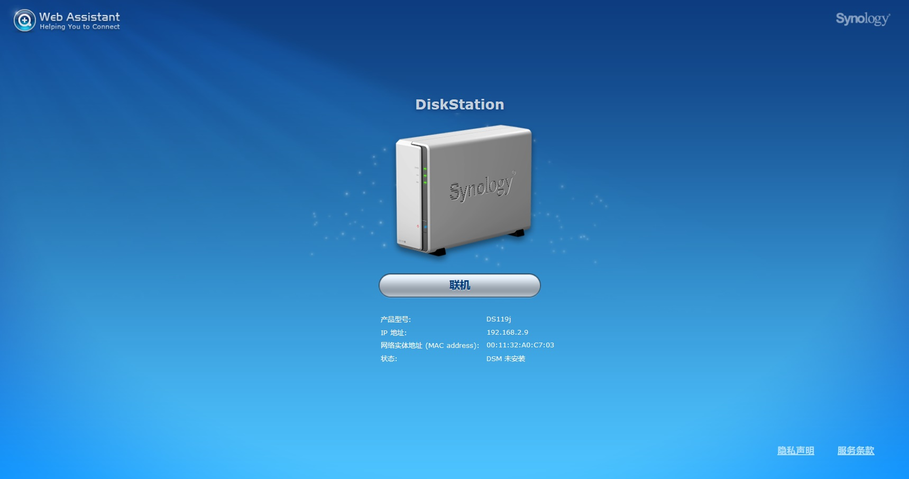](images/10-catdrive-08.jpg)

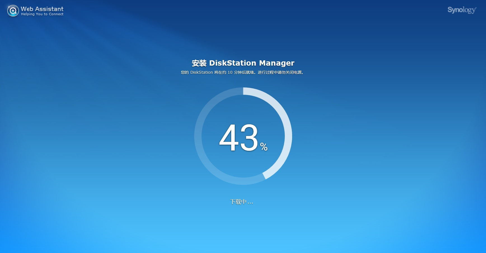

默认是直接在线获取最新固件，如果猫盘没联网的话，也可以手动下载官网固件进行安装，官方下载地址为：[https://www.synology.cn/zh-cn/support/download/DS119j#firmware](https://www.synology.cn/zh-cn/support/download/DS119j#firmware)

装完提示重启，页面会有10分钟的倒计时，实际不需要这么久，大概等个三四分钟就行。重启后设定好设备名称和管理员账户后就完成了群晖设置，可以直接使用了：

[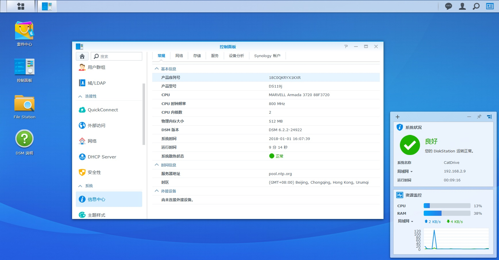](images/12-catdrive-10.jpg)

另外再说一下硬盘休眠问题，由于猫盘装的是2.5寸盘，不如3.5寸那么耐艹，开启休眠可以保护下硬盘寿命，现在控制面板里开启SSH功能，然后使用putty等客户端进行连接，用户名密码就是群晖管理员的用户名密码：

[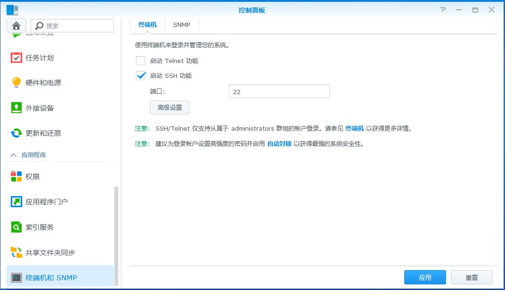](images/13-catdrive-11.jpg)

编辑/etc/init目录下的syslog-ng.conf 文件，输入：

```bash
sudo vi /etc/init/syslog-ng.conf
```

会提示再次输入密码，然后按i进入编辑模式，定位到50行左右，如红框里所示插入这一段语句：

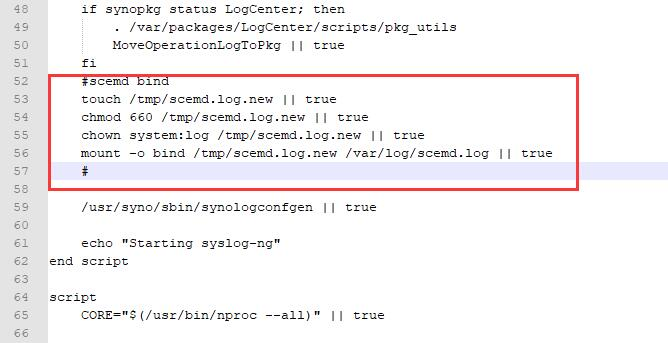

```bash
#scemd bind
touch /tmp/scemd.log.new || true
chmod 660 /tmp/scemd.log.new || true
chown system:log /tmp/scemd.log.new || true
mount -o bind /tmp/scemd.log.new /var/log/scemd.log || true
#
```

改完后按esc，然后输入`:wq`退出编辑，重启群晖。

重启后去套件中心里安装日志中心工具，过一段时间去查看日志，如果看到有箭头所指的这种Internal disks woke up from hibernation日志，就说明硬盘休眠功能正常。

[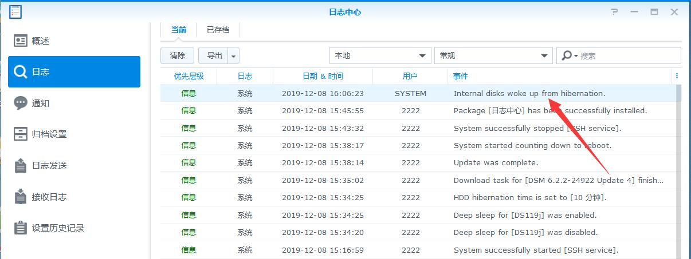](images/15-catdrive-13.jpg)

**[上一篇](https://lishuma.com/archives/2354)　|　[下一篇](https://lishuma.com/archives/3007)**

---

> 版权属于: [梨数码](https://lishuma.com) 原文地址: [https://lishuma.com/archives/2974](https://lishuma.com/archives/2974) 转载时必须以链接形式注明原始出处及本声明。

---

## 附：正文相关链接

- [https://pan.baidu.com/s/18SlbzsQPfu3FneP24FuS4A](https://pan.baidu.com/s/18SlbzsQPfu3FneP24FuS4A)
- [https://cloud.189.cn/t/N7vYNj2aqU73](https://cloud.189.cn/t/N7vYNj2aqU73)
- [http://find.synology.com/](http://find.synology.com/)
- [https://www.synology.cn/zh-cn/support/download/DS119j#firmware](https://www.synology.cn/zh-cn/support/download/DS119j#firmware)
- [梨数码](https://lishuma.com)
- [https://lishuma.com/archives/2974](https://lishuma.com/archives/2974)
