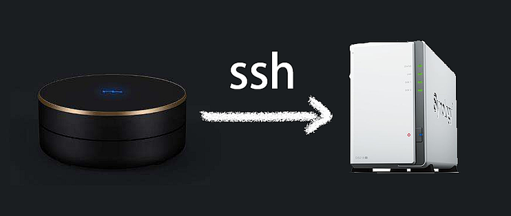
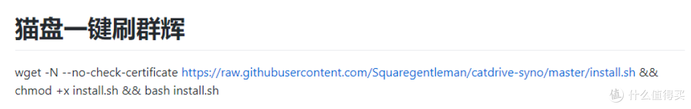
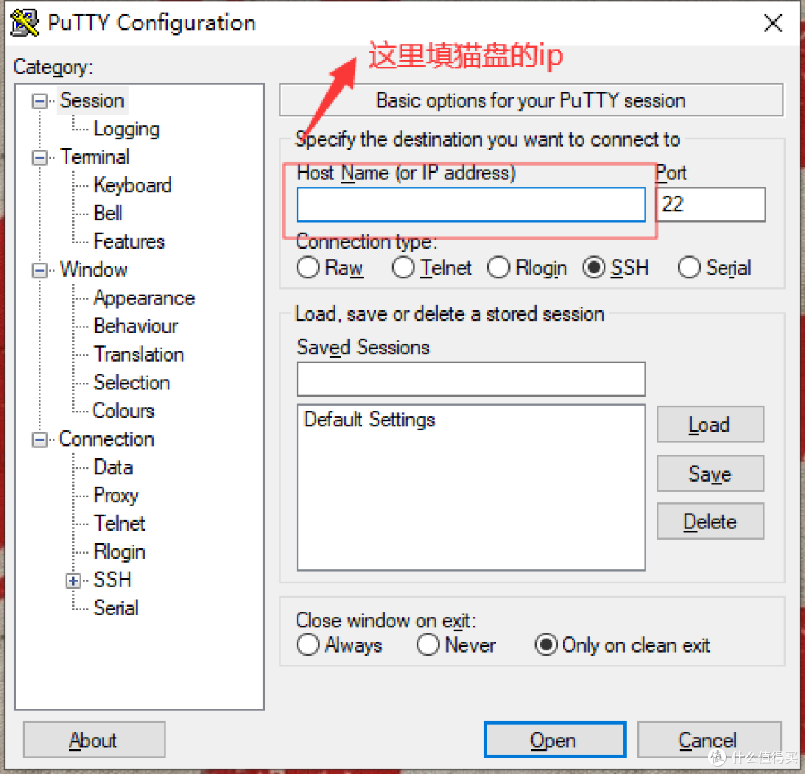
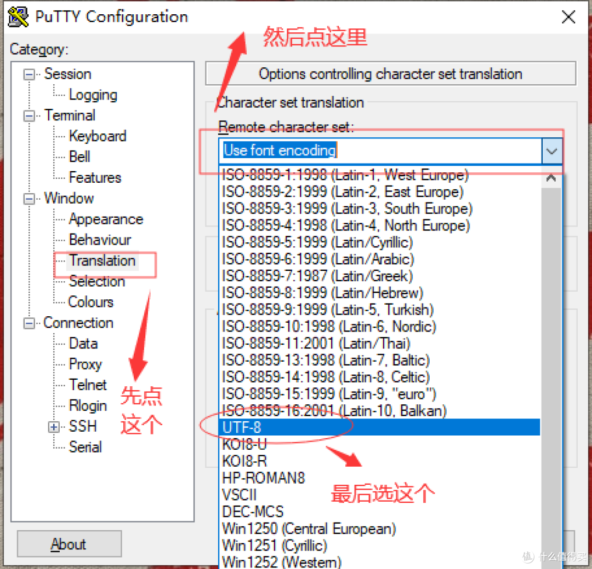
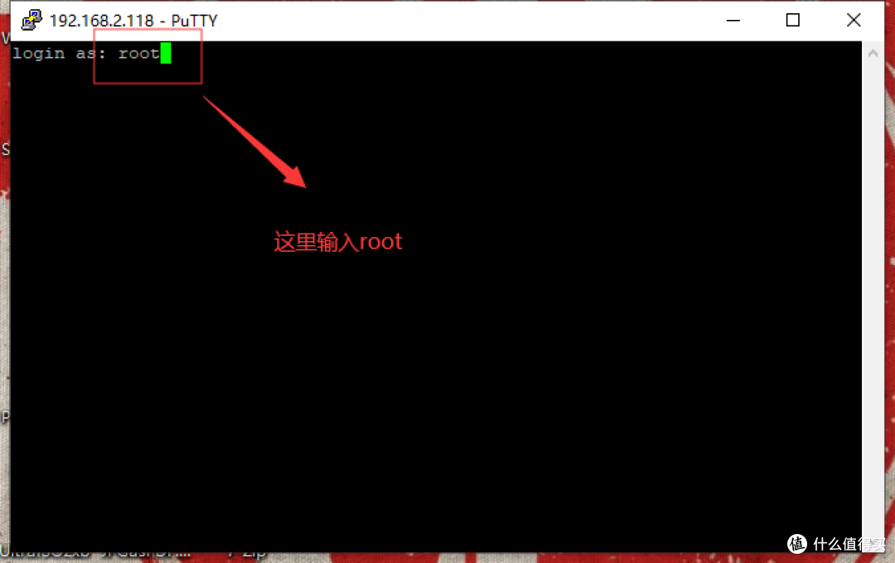
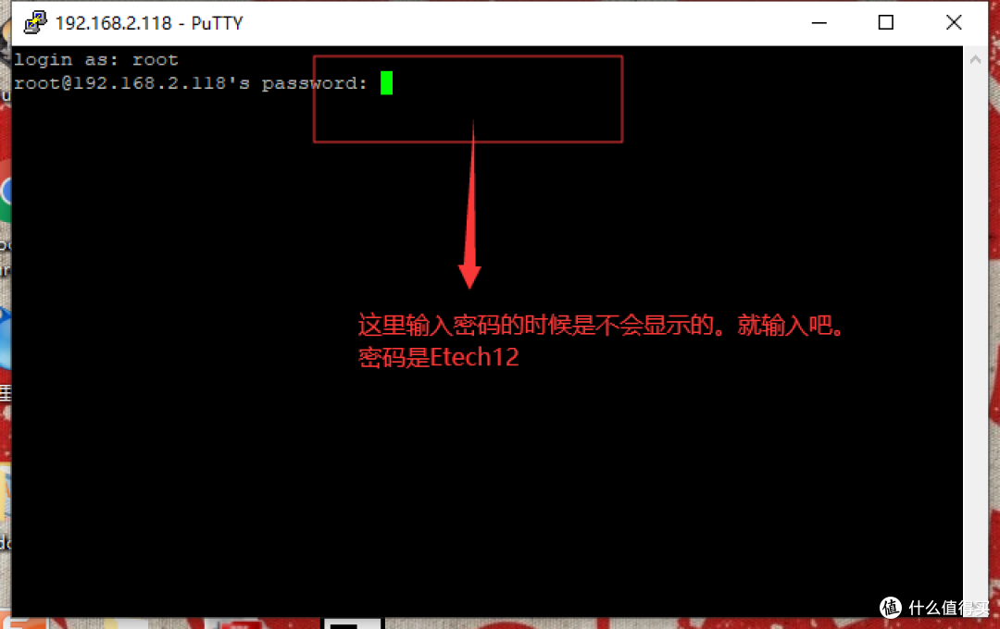
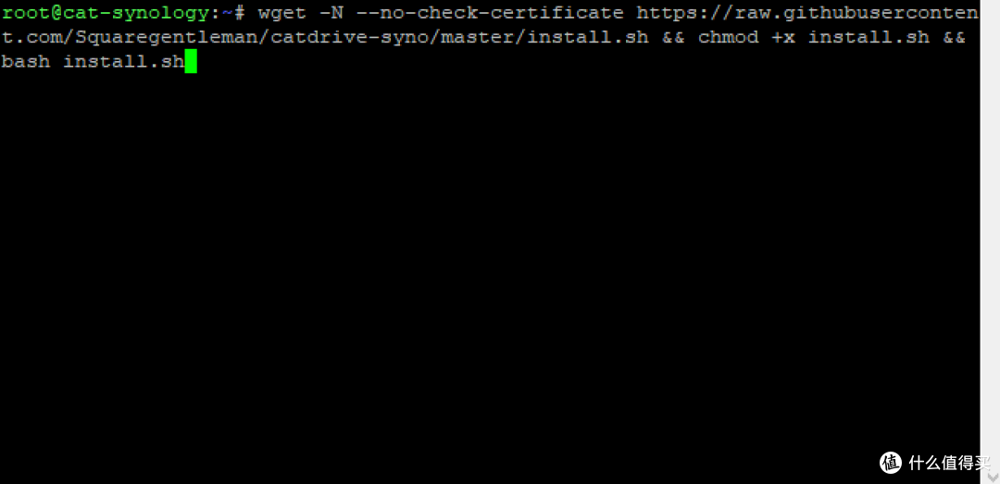
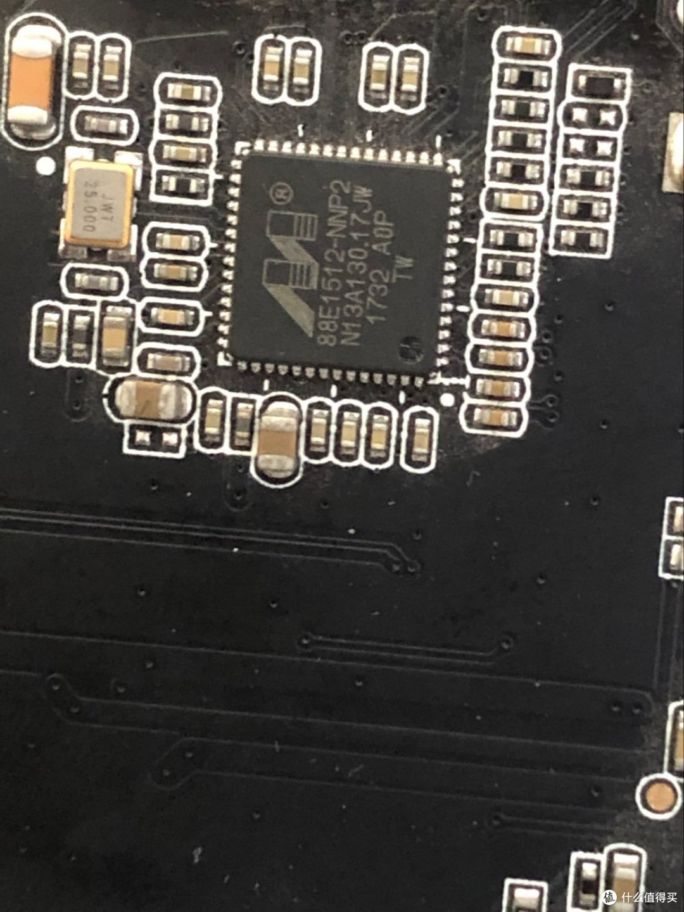
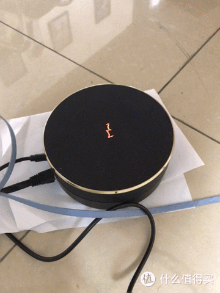

# 猫盘最速刷群晖(一秒输入命令。十分钟给你一个群晖)



> **作者**：xiongyanbo　|　**分类**：NAS存储　|　**发布**：2019-11-29 15:38:10
> **数据**：42 点赞 · 444 收藏 · 237 评论
> **原文**：<https://post.smzdm.com/p/aqnlrqdv/>

---

猫盘是大家的老朋友了。刷机教程非常多。老板们是不是看着一条条的步骤头痛。是不是一不小心刷成砖头？毕竟不是所有人都是[电脑](https://www.smzdm.com/ju/sp4x11p/)专家。。

好消息来了。一条命令刷机。傻瓜教程。没有变砖烦恼。

此教程最烦人的一步是打开猫盘的ssh。最爽快的一步是在ssh窗口复制一条刷机命令。

这是[出处](https://github.com/Squaregentleman/catdrive-syno)。方块君。要感谢这个人。命令就一行我贴在最前面：

```bash
wget -N --no-check-certificate https://raw.githubusercontent.com/Squaregentleman/catdrive-syno/master/install.sh && chmod +x install.sh && bash install.sh
```

我还是截个图。之前的[群晖](https://pinpai.smzdm.com/2315/)自动更换壁纸。代码就变了。有老板提醒我了。这次我截个图。大家可以对比一下。

[](images/img_01.png)

*实在不行。对着图敲代码页一样的。*

这段代码是要在ssh里输入的。我先发个工具。绿色的。putty。各位也可以自备。[下载地址](https://pan.baidu.com/s/1PTbcUqpRGybdsji7nh8atg) **提取码: guba**

**下面说一下ssh的用法。（我感觉还是有必要的。不是人人都是电脑高手）**

[](images/img_02.png)

*第一步。填猫盘的ip*

[](images/img_03.png)

*第二步改设置。不然会有乱码*

[](images/img_04.png)

*这是已经登陆进去了*

[](images/img_05.png)

*输入密码*

这里猫盘的密码:用户名 **root** 密码 **Etech12**

**然后复制上面的命令。然后在这个黑黑的窗口按一下[鼠标](https://www.smzdm.com/fenlei/shubiao/)右键就拷贝上去了。然后回车。**

[](images/img_06.png)

*这样就对了*

然后等个大概10分钟。。最后会显示：

```text
安装成功，猫盘已自动重启！
请访问http://find.synology.com/搜索您的群辉
```

原谅我不能截图。因为我已经刷好了。。。之前如果putty没有改设置。**中文就会显示乱码。**

之后就是安装群晖了。这个教程很多很多。我就不水了。(教程就结束了？这补坑爹么？ )

但是。。。（重点来了！！！大家要看重点）

市面上能买的猫盘。现在大约就是两种了：

## 1.刷好单群的猫盘。这种120左右的价钱

## 2.不能群晖的猫。是x3p的系统(这里有坑)

## 还有就是老板们手上的猫。大多是x3p系统。（我感觉！）因为教程又是ttl。又是usb接口。。看的脑壳痛。

---

单群猫我们不谈。这个已经是群晖了。买来就好好用。我着重说下第二种。只能刷x3p的猫盘。为什们说只能x3p？？因为你刷了群晖会找不到ip!!找不到ip。。这就没法用了。。或许你重启个几遍能找到ip。但是就算你侥幸进去了。还是会丢包。数据传输不稳。。。（废话这么多。就是不能正常使用群晖。 ）这种猫盘。老板们可以拆开猫盘看一下这个部位：

[](images/img_07.jpg)

*这个写的大写M的芯片*

倒数第二排写的1732（17年第32周出厂。）据大佬们研究和这个芯片有关系。1819容易找不到ip（我的就是1819.但是不掉ip。）老板们如果遇到掉ip。评论里面告诉我一下这四个数字是什么！！谢谢

**遇到这个情况。买来就是x3p的。就最好不要实验了。卖家肯定都试过。能刷的都卖单群猫的价钱了。**

手里自己刷x3p的老板。可以试试！！

但是。。但是又来了。老板非要实验。我这里提供一个群晖刷回x3p的教程。以备不时之需。（这个需要ttl线）

[**救命地址**](https://pan.baidu.com/s/1oOS1i4FG-yitElVw5bLVtA)  提取码: a1jy

好的！教程结束。谢谢观看。谢谢

[](images/img_08.gif)

*七彩灯炫酷不炫酷？*


---

## 附：正文相关链接

- [电脑](https://www.smzdm.com/ju/sp4x11p/)
- [出处](https://github.com/Squaregentleman/catdrive-syno)
- [https://raw.githubusercontent.com/Squaregentleman/catdrive-syno/master/install.sh](https://raw.githubusercontent.com/Squaregentleman/catdrive-syno/master/install.sh)
- [群晖](https://pinpai.smzdm.com/2315/)
- [下载地址](https://pan.baidu.com/s/1PTbcUqpRGybdsji7nh8atg)
- [鼠标](https://www.smzdm.com/fenlei/shubiao/)
- [救命地址](https://pan.baidu.com/s/1oOS1i4FG-yitElVw5bLVtA)

- putty 下载提取码：`guba`
- 群晖刷回 X3P 教程提取码：`a1jy`
