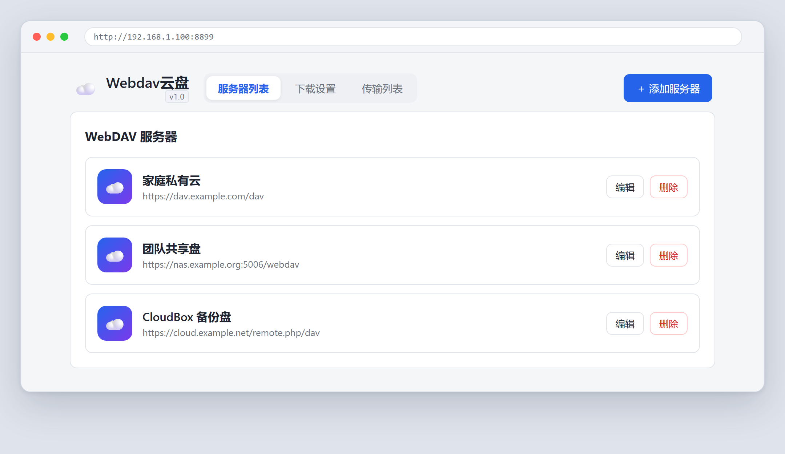
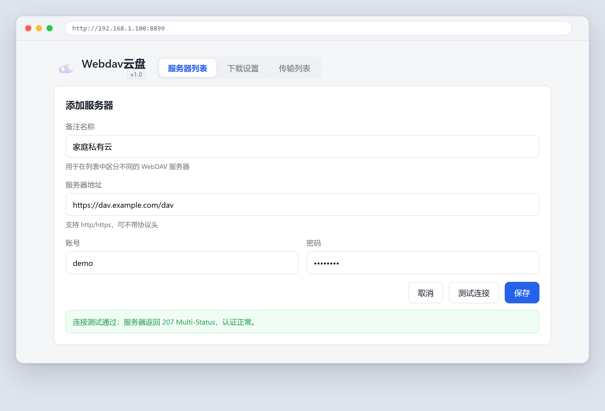
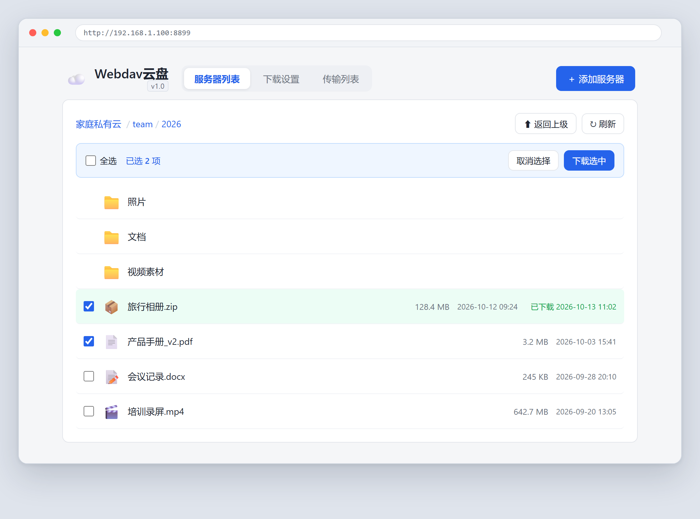
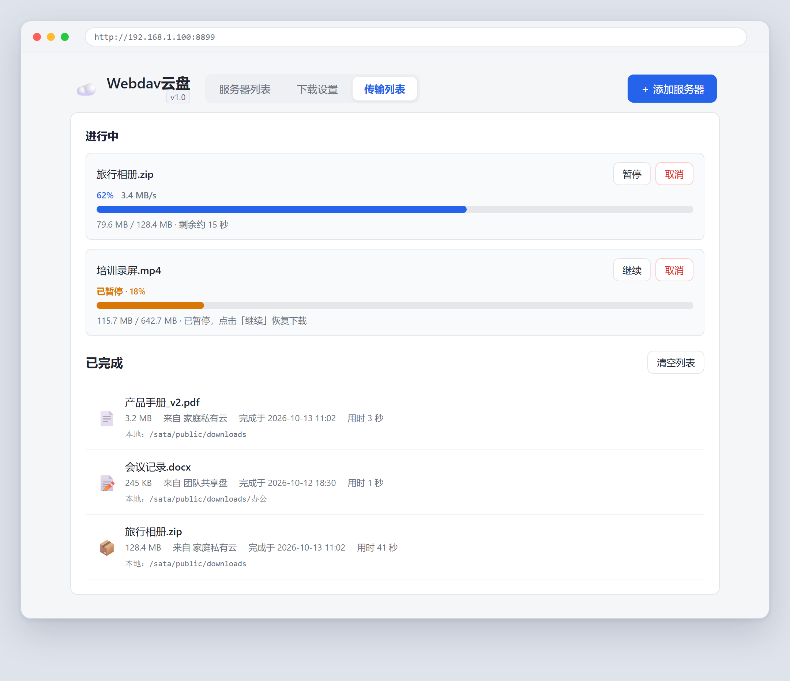
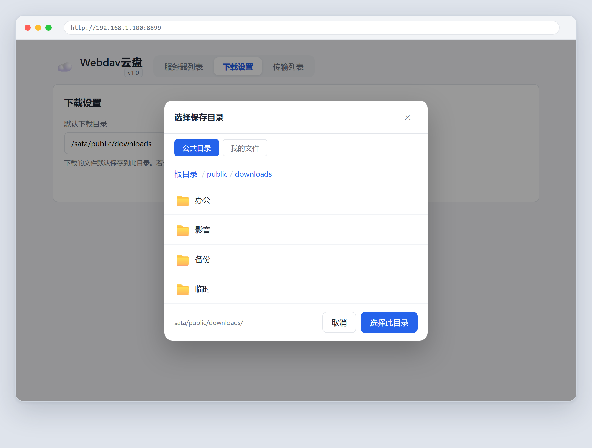

# Webdav云盘 · 应用说明

> 版本：**v1.0**　|　应用标识：`webdav`　|　类型：独立端口 Web 应用（默认 8899）　|　适用：大猫盘 NAS（X3P / OneOS，ARM）

一个装在 NAS 上的 **WebDAV 客户端**：把多个 WebDAV 网盘挂到同一个页面里，浏览目录、挑文件、直接下载到 NAS 本地存储。

无需 Docker、无需 `npm install`，后端只依赖 Node.js 内置模块，适合离线、低配的 NAS 环境。

---

## 目录

- [一、它解决什么问题](#一它解决什么问题)
- [二、功能一览](#二功能一览)
- [三、界面演示](#三界面演示)
- [四、安装与部署](#四安装与部署)
- [五、配置说明](#五配置说明)
- [六、目录结构](#六目录结构)
- [七、常见问题](#七常见问题)
- [八、安全说明（请务必阅读）](#八安全说明请务必阅读)
- [九、版本记录](#九版本记录)
- [十、技术要点](#十技术要点)

---

## 一、它解决什么问题

NAS 本身通常只做 SMB/WebDAV **服务端**，要把别人家的 WebDAV 网盘（私有云、坚果云、Nextcloud、群晖 WebDAV……）里的文件搬到 NAS 上，一般得开电脑、装同步客户端。

这个应用把这件事变成：**打开浏览器 → 选服务器 → 点文件 → 下载到 NAS 目录**，全程在设备内网完成，不经过第三方。

---

## 二、功能一览

| 能力 | 说明 |
|---|---|
| 多服务器管理 | 可保存任意多个 WebDAV 连接，各带备注名，列表内直接编辑 / 删除 |
| 连接测试 | 保存前一键测试，返回 `207 Multi-Status` 之类的真实响应 |
| 目录浏览 | 面包屑导航、返回上级、刷新；目录可无限层级进入 |
| 单文件下载 | 点击文件即下载到 NAS 本地，实时显示百分比、速度、已传/总量、剩余时间 |
| 批量下载 | 勾选多个文件（支持全选）一次性下载，逐个执行 |
| 下载控制 | 进行中任务支持**暂停 / 继续 / 取消**，失败任务可移除 |
| 传输列表 | 「进行中」+「已完成」两段式，历史记录含来源服务器、耗时、落地路径 |
| 已下载标记 | 浏览时对已下载过的文件高亮标绿，并显示上次下载时间 |
| 自定义保存目录 | 内置目录选择器，可浏览 NAS 的「公共目录」与「我的文件」任意子目录 |
| 错误提示 | 连接失败 / 认证失败(401) / 超时 / 服务器错误，分别给出可读中文提示 |
| 凭据保护 | 密码不明文落盘，XOR + Base64 混淆后存入配置文件 |
| 版本显示 | 首页「Webdav云盘」标题右下角显示当前版本号，取自 `app/conf.js`，与应用中心一致 |

---

## 三、界面演示

### 1. 服务器列表（首页）

所有已保存的 WebDAV 连接集中在这里，点卡片即进入该网盘根目录。标题右下角的 `v1.0` 角标是当前应用版本，鼠标悬停可看到内部版本号。



*图 1　服务器列表：每张卡片是一个 WebDAV 连接，点进去即浏览该网盘*

### 2. 添加 / 编辑服务器

备注名称、服务器地址、账号、密码四项即可完成配置；先「测试连接」再「保存」最稳妥。



*图 2　添加服务器：四项信息即可完成配置，先「测试连接」再「保存」*

- 地址支持 `http` / `https`，不带协议头也会自动补 `http://`
- 地址要写到 WebDAV 端点，例如 `https://dav.example.com/dav`、`https://nas.example.org:5006/webdav`
- 编辑已有连接时，密码留空表示不修改

### 3. 文件浏览与批量下载

面包屑显示当前路径，勾选文件后可一次下载多个；已下载过的文件会整行标绿并注明时间。



*图 3　文件浏览：目录与文件混排，已下载过的行整行标绿并注明时间*

- 目录行左侧无勾选框，点击整行进入子目录
- 点击文件行即选中（与勾选框联动），顶部蓝条显示已选数量
- 右侧「下载选中」开始排队下载

### 4. 传输列表

下载任务的实时看板：进度条、速度、剩余时间，以及历史完成记录。



*图 4　传输列表：进行中任务带速度与剩余时间，已完成记录可回溯落地路径*

- 进行中：可暂停 / 继续 / 取消
- 已完成：显示大小、来源服务器、完成时间、耗时、落地目录
- 「清空列表」只清记录，不删除本地文件

### 5. 选择保存目录

下载前可指定落地位置，支持「公共目录」与「我的文件」两个根，逐层点进去选。



*图 5　选择保存目录：公共目录 / 我的文件两个根，逐层进入选目录*

---

## 四、安装与部署

### 前置条件

- 设备已具备 Node.js（X3P 固件自带 `node v6.7.0`，已验证可用）
- 设备剩余空间足够存放待下载文件
- 本机与设备在同一局域网

### 步骤

1. 把 `webdav.app` 与 `deploy.sh` 放到同一目录；
2. 上传到设备临时目录：

```sh
scp webdav.app deploy.sh root@<NAS_IP>:/tmp/
```

3. 在设备上执行部署：

```sh
ssh root@<NAS_IP>
cd /tmp && sh deploy.sh
```

4. 浏览器访问 `http://<NAS_IP>:8899`。

部署脚本会依次完成：检查 Node 环境 → 解压到 `/sata/app/webdav/` → 补全控制脚本权限 → 调用 `app/on.sh` 启动 → 校验状态并打印访问地址。

### 应用中心

安装完成后，X3P 管理后台（`http://<NAS_IP>/setting/`）的应用中心会出现「Webdav云盘」：iOS 风格图标、版本号、启动/停止/卸载按钮均可用。

### 卸载

应用中心点「卸载」即可，等价于执行 `/sata/app/webdav/app/del.sh`，会删除 `/sata/app/webdav/` 整目录。

> ⚠️ 卸载会连 `downloads/` 里已下载的文件一起删掉，请先把要保留的文件移到别的目录。

---

## 五、配置说明

### 元数据 `app/conf.js`

| 字段 | 当前值 | 含义 |
|---|---|---|
| `pack` | `webdav` | 应用唯一标识，同时是安装目录名 |
| `ver` / `verno` | `1.0` / `100` | 显示版本 / 整数版本（升级需递增，`verno` 只增不减） |
| `name` | `Webdav云盘` | 应用中心显示名 |
| `logo` | `app.png` | 图标文件名 |
| `web` | `false` | `false` = 独立端口型应用，服务自己监听端口 |
| `url` | `/` | 入口路径 |
| `port` | `8899` | 监听端口，冲突时可改 |
| `canstat` / `canoff` / `candel` | `true` | 是否允许查询状态 / 停止 / 卸载 |

改端口时要同时改三处：`conf.js` 的 `port`、`bin/start.sh` 的 `PORT`、`deploy.sh` 的 `PORT`。

### 运行时可覆盖的环境变量

| 变量 | 默认值 | 用途 |
|---|---|---|
| `PORT` | `8899` | 监听端口 |
| `X3P_APP_DIR` | 程序所在目录 | 配置与下载目录的基准路径 |
| `X3P_DOWNLOAD_DIR` | `<APP_DIR>/downloads` | 默认下载落地目录 |
| `X3P_LOCAL_ROOT` | `/sata/public` | 「公共目录」根 |
| `X3P_HOME_ROOT` | `/sata/home/admin` | 「我的文件」根（按实际账号调整） |

### 运行时生成的文件

| 路径 | 内容 |
|---|---|
| `config/webdav-config.json` | 服务器列表（含混淆后的密码）、默认下载目录 |
| `config/download-history.json` | 下载历史记录 |
| `downloads/` | 默认下载落地目录 |
| `webdav.pid` | 进程号，`stat.sh` 据此判断运行状态 |
| `webdav.log` | 运行日志 |

---

## 六、目录结构

### 源码

```
webdav-app/
├── app/
│   ├── conf.js          # 应用元数据
│   ├── app.sh           # 主控制脚本（按 basename $0 区分 on/off/stat/del）
│   ├── app.png          # 图标
│   └── on.sh off.sh stat.sh del.sh
├── bin/
│   ├── start.sh         # 启动（定位 node、写 pid、拉起 server.js）
│   └── stop.sh          # 停止（按 pid 结束 + 兜底 pkill）
├── public/
│   ├── index.html       # 页面骨架
│   ├── app.js           # 前端逻辑（列表、浏览、下载、目录选择器）
│   └── style.css        # 样式
├── server.js            # 后端（仅 Node 内置模块）
├── package.json
├── build.sh             # 本地打包 → dist/webdav.app
├── deploy.sh            # 设备端一键部署
└── dist/webdav.app      # 构建产物
```

### 安装后（设备上）

```
/sata/app/webdav/
├── app/  bin/  web/
├── server.js
├── config/              # 运行时生成
├── downloads/           # 运行时生成
├── webdav.pid           # 运行时生成
└── webdav.log           # 运行时生成
```

---

## 七、常见问题

| 现象 | 排查方向 |
|---|---|
| 网页打不开 | `cat /sata/app/webdav/webdav.pid` 看进程是否在；`sh app/stat.sh` 应输出 `on`；看 `webdav.log` |
| 应用中心看不到图标 | 确认 `app/conf.js` 存在且 JSON 合法（多一个逗号就会解析失败） |
| 提示「认证失败」 | WebDAV 账号/密码错误，或该服务需要「应用专用密码」 |
| 提示「连接超时」 | 地址写错、端口被防火墙拦、或目标服务器在内网另一侧 |
| 能列目录但下载失败 | 多为目标服务的下载链接需要跟随重定向或额外鉴权；看日志里的状态码 |
| 下载卡在 0% | 目标文件较大且服务端不返回 `Content-Length` 时进度可能滞后，留意速度字段是否有变化 |
| 端口 8899 被占用 | 改 `conf.js` / `start.sh` / `deploy.sh` 三处端口后重新部署 |
| 重启设备后应用没自启 | 由系统应用中心托管，确认应用处于「启用」而非「停用」状态（停用会写入 `/sata/.storage/appblock/webdav`） |

---

## 八、安全说明（请务必阅读）

1. **密码是「混淆」不是「加密」**：`config/webdav-config.json` 里的密码经 XOR + Base64 处理，能防肉眼直读，但**不能防有心人**。请勿在多人共用的设备上保存高权限账号。
2. **本应用没有登录鉴权**：任何能访问 `http://<NAS_IP>:8899` 的人都能看到你配置的服务器列表（密码不回显）。**只在内网使用，不要把端口映射到公网。**
3. **建议走 https**：WebDAV 的 Basic 认证在 http 下是明文传输凭据，公网环境请务必使用 `https://` 地址。
4. **凭据不落到浏览器**：前端不持久化密码，刷新后需重新从后端读取（编辑回填时才会取一次明文）。

---

## 九、版本记录

| 版本 | 变更 |
|---|---|
| **v1.0** | **首个对外发布版本**。功能集合：多服务器管理、连接测试、目录浏览、单文件/批量下载、暂停继续取消、传输列表与历史、已下载标记、自定义保存目录；本版新增首页版本号角标（`/api/version` 读 `app/conf.js`）、静态资源带 `?v=` 版本串避免升级后浏览器读旧缓存；源码脱敏、打包归档统一属主、补充应用说明与界面演示 |

> 版本号说明：对外发布统一从 **v1.0** 起算（`verno = 100`）。此前开发过程中的 2.1.x / 2.0.0 / 1.0.0 属于内部迭代编号，功能已全部并入 v1.0，不再单独发布。

---

## 十、技术要点

- **零依赖**：后端只用 `http / https / url / fs / path / crypto`，不需要联网装包
- **Node v6 兼容**：不使用 `async/await`、对象展开、`mkdirSync({recursive})`，可在老固件上跑
- **前后端分离但同源**：前端为原生 HTML/CSS/JS，由 `server.js` 静态托管，无构建步骤
- **版本号单一来源**：`app/conf.js` 是唯一出处，后端 `/api/version` 读取后回给前端角标，改版本只改一个文件
- **下载走流式转发**：服务端以流方式拉取远程文件并写入本地，边传边算进度，不占内存
- **跨域重定向剥凭据**：跟随重定向到其他主机时会去掉 `Authorization`，避免凭据泄露给 CDN

---

*文档随源码一同发布。界面演示图由真实样式（`public/style.css`）渲染生成，示例中的服务器地址、账号、文件名均为虚构。*
